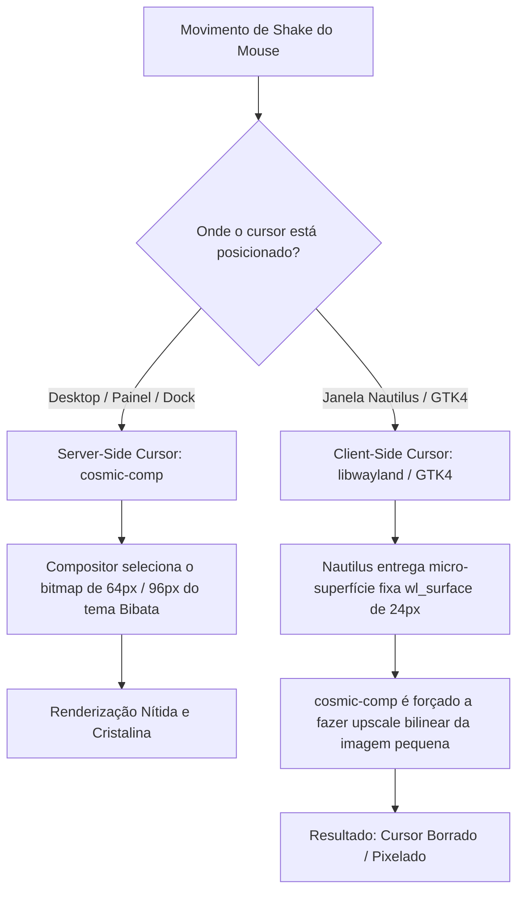

# 🖱️ Issue Técnica: Desfoque / Borrão no Cursor ao Balançar Sobre Janelas GTK4 (Nautilus) no Wayland

## 📌 Contexto & Sintomas

* **Ambiente:** Pop!_OS 24.04 LTS com COSMIC Desktop (`cosmic-comp`) sob sessão Wayland nativa.
* **Tema de Cursores:** `Bibata-Modern-Classic` (ou qualquer tema moderno com múltiplas resoluções HiDPI embutidas).
* **Recurso:** *Shake to find cursor* (Balançar o mouse rapidamente para aumentar o tamanho do cursor e localizá-lo na tela).
* **Comportamento Observado:**
  * Sobre o papel de parede (desktop), painel superior ou dock do COSMIC, o cursor cresce de forma perfeitamente nítida e com bordas suaves (vetorizadas).
  * Ao passar ou balançar o cursor sobre a janela do **Nautilus (Arquivos / GTK4)** ou outros clientes gráficos de terceiros, o cursor ampliado fica visivelmente borrado (*blurry*) e pixelado.
  * Assim que o cursor sai da janela do Nautilus e volta para o desktop, ele recupera imediatamente sua nitidez total.
* **Registro em Vídeo:** Documentado na gravação de teste em [`temp/Kooha-2026-10-22-09-43-01.mp4`](../temp/Kooha-2026-10-22-09-43-01.mp4).

---

## 🔍 Causa Raiz Técnica: Server-Side vs. Client-Side Cursor no Wayland

A divergência visual ocorre pela coexistência de dois paradigmas de renderização de ponteiro no protocolo Wayland:

1. **Server-Side Cursor (Gerenciado pelo `cosmic-comp`):**
   * Em superfícies do próprio compositor, o `cosmic-comp` tem acesso direto à tabela TOC do tema XCursor (`Bibata-Modern-Classic`), que contém 14 resoluções diferentes (`16, 20, 22, 24, 28, 32, 40, 48, 56, 64, 72, 80, 88, 96px`).
   * Ao detectar o balanço, o compositor renderiza o cursor diretamente da camada de maior resolução (`96px`), mantendo fidelidade absoluta.

2. **Client-Side Cursor (Legado do GTK4 / Libwayland):**
   * No modelo Wayland clássico, aplicativos clientes são responsáveis por criar e fornecer uma `wl_surface` para o ponteiro do mouse quando este se encontra dentro de suas janelas.
   * O Nautilus instancia a textura do cursor com o tamanho base padrão configurado (`24px`).
   * O aplicativo cliente não sabe que o usuário está balançando o mouse para aumentá-lo. Quem sabe disso é apenas o compositor (`cosmic-comp`).
   * Como o cliente não troca dinamicamente a sua `wl_surface` para uma textura maior, o compositor não tem outra escolha a não ser ampliar via software (interpolação bilinear) a textura de 24px existente, gerando o desfoque visual.

---

## 🌐 Rastreamento Upstream & Migração de Protocolo

Esta limitação arquitetural já é conhecida pela comunidade Wayland e pelas equipes da System76 e GNOME:

### 1. Issues Oficiais para Acompanhamento
* **System76 / COSMIC Desktop Compositor:**
  * [pop-os/cosmic-comp #789](https://github.com/pop-os/cosmic-comp/issues/789) — *Mouse cursor on scaled display / surface renders blurry on most windows*
  * [pop-os/cosmic-epoch #120](https://github.com/pop-os/cosmic-epoch/issues) — *Wayland cursor shape integration and fractional scaling roadmap*
* **Wayland Protocols Upstream:**
  * [wayland/wayland-protocols `wp_cursor_shape_v1`](https://gitlab.freedesktop.org/wayland/wayland-protocols/-/merge_requests/181) — *Cursor Shape Protocol Specification*

### 2. A Solução Definitiva: Adoção do `wp_cursor_shape_v1`
* **Como funciona a nova especificação:**
  * Com o novo protocolo `wp_cursor_shape_v1`, os clientes (Nautilus, navegadores, editores) **deixam de renderizar superfícies gráficas de cursor**.
  * O aplicativo envia apenas uma mensagem semântica leve para o compositor, como: `wp_cursor_shape_device_v1.set_shape(default)` ou `set_shape(pointer)`.
  * O compositor Wayland assume 100% da responsabilidade pelo desenho da textura em todas as telas, garantindo que o efeito de *shake to find*, escala fracionária e temas HiDPI fiquem uniformemente nítidos em qualquer aplicativo.
* **Status Atual:**
  * O `cosmic-comp` e o GTK4 já possuem código preliminar para o protocolo. À medida que as atualizações de pacotes do Pop!_OS 24.04 LTS amadurecerem o suporte nas bibliotecas do sistema, o desfoque desaparecerá automaticamente sem necessidade de alterações manuais.

---

## 🛠️ Configuração Aplicada no Workstation

No setup do Pop!_OS, garantimos que todos os pré-requisitos ideais já estejam ativos:

1. **Tema Bibata Modern Classic Multi-DPI:**
   * Instalado em `~/.local/share/icons/Bibata-Modern-Classic` e provido no APT (`bibata-cursor-theme`).
   * Suporte completo compilado para resoluções de `16px` a `96px`.
2. **Declaração Global em Variáveis de Ambiente:**
   * `~/.config/environment.d/10-cursor.conf` (`XCURSOR_THEME="Bibata-Modern-Classic"`, `XCURSOR_SIZE="24"`).
   * `~/.icons/default/index.theme` configurado com `Inherits=Bibata-Modern-Classic`.
   * GSettings configurado com `org.gnome.desktop.interface cursor-theme 'Bibata-Modern-Classic'`.
3. **Idempotência no Script Oficial:**
   * Registrado e preservado em [`scripts/14_cosmic_theme_restore.sh`](../scripts/14_cosmic_theme_restore.sh).

> [!NOTE]
> **Recomendação Atual:** Manter o uso normal do sistema. O efeito de crescimento cumpre seu papel ergonômico de localização, e a nitidez em janelas client-side será gradualmente unificada com a evolução do protocolo `wp_cursor_shape_v1` nas atualizações automáticas do Pop!_OS.
